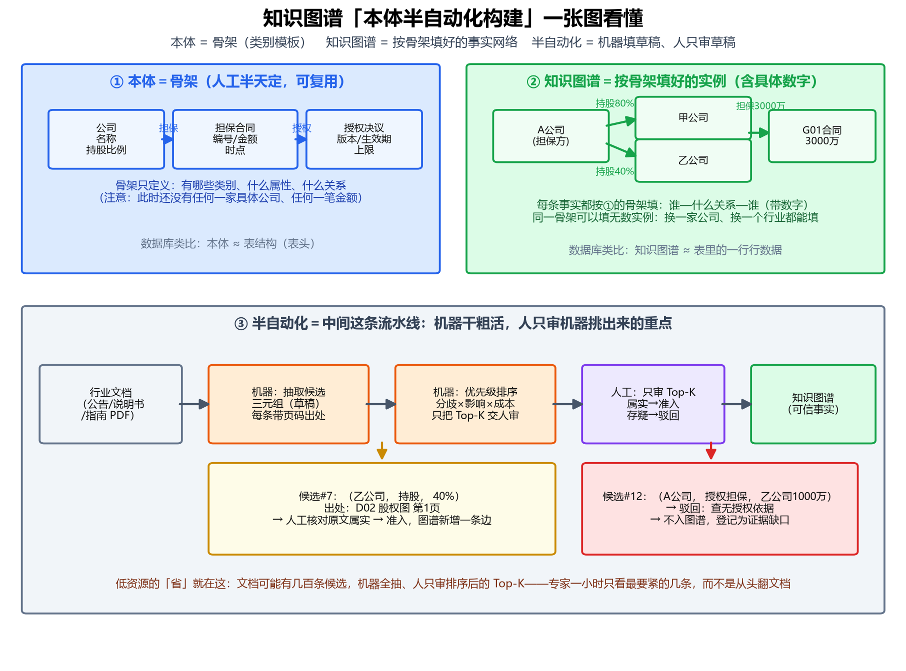

# 03 知识图谱构建方案

上图：①本体是骨架（类别/属性/关系的模板，人工半天可定、跨行业复用）；②知识图谱是按骨架填好的实例（含具体数字）；③半自动化流水线＝机器抽候选 → 机器按"分歧×影响×成本"排序 → 人工只审 Top-K → 准入/驳回入图谱。

## 五步流水线（可直接写入设计文档）

| 步骤 | 谁干 | 做什么 | 本项目现状 |
|---|---|---|---|
| 1 种子本体 | 人工 | 定骨架：金融版约 10-15 个概念（公司、担保合同、授权决议、持股关系、余额口径）；医疗版见迁移方案 | 待定稿 |
| 2 机器抽取 | 机器 | LLM 批量抽候选三元组，**每条强制带页码出处** | 待做（P4/P5 阶段） |
| 3 确定性对齐 | 规则 | 跨文档对齐（合同编号合并）、单位归一、时点对齐、冲突并列 | C02/C06 已验 |
| 4 候选审核 | 人工 | 按优先级排序后只审 Top-K，属实准入/存疑驳回，驳回登记为证据缺口 | C08 a 轮示范 |
| 5 版本演化 | 机器+人 | 三分更新分流，结构变更须先 gap analysis，变更写日志、历史版本保留 | C08 a 轮示范 |

## 已确认

- 低资源路线：少量人工定义**种子本体**，从文档中发现候选概念与关系；有限的人工审核预算优先给"最影响业务判断"的候选。
- 本体变更触发条件：仅当现有本体**无法表达**必要的概念/属性/关系时才改结构。数值变化属事实更新，不改本体（例：担保余额变化 ≠ 本体演化；发现需要表达"多次担保各自的金额、期限与授权依据"而现有结构表达不了，才新增"担保事项"对象及属性）。
- 评估口径：本体质量 + 业务任务正确率双指标；对照实验设计见 docs/plan.md A5（随机 / 按不确定性 / 按业务影响优先三种审核策略）。
- 效率证明指标：构建同等规模本体的专家小时数（纯人工 vs 机器抽取+人审 Top-K）、单位人工审核的知识增益、抽取召回/准确率、下游任务正确率提升——均待 A5 实验产出。

## 待补

- 种子本体 v1 定义（担保事项、授权决议、计量口径等对象与属性）——建议 C08 完成后定稿
- 半自动化本体构建效率对比数据（A5 实验产出后补入）
